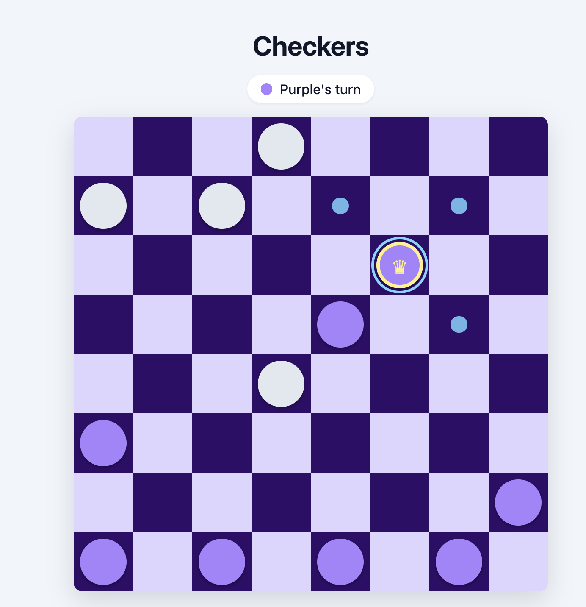

# Project Log: Checkers Game

**Course:** C S 191 AI Project
**Project:** Two-player checkers game in pure HTML, CSS, and JavaScript
**Files:** `index.html`, `style.css`, `script.js`, `plan.md`

---

## What We Built

Claude and I built a simple game of checkers that follows standard American rules: no backwards captures, captures required, kings move one space at a time, etc.

## What I Learned

I learned how to use Claude Code and just how useful it can be. I had never worked with it before and it was really cool to see just how much faster I could get a project done when I delegated to it.

## Changes I Made

I changed the theme from a basic slate and white to a two-toned purple theme.

I also changed the names of the players from 'Dark' and 'Light' to 'Purple' and 'White'

---

## Discussion Log

This is a summary of each request I made during the project and how the AI assistant (Claude) responded.

### 1. Planning the project
**My request:** Build a checkers game in pure HTML, CSS, and JavaScript. Before writing any code, make a plan with specific milestones for a `.md` file, ask me one question at a time about the specifications, and don't write code until I say so.

**How Claude responded:** Claude asked one multiple-choice question at a time and did not write any code. My answers set these specs:

| Question | My answer |
|---|---|
| Who plays? | Two players on one device |
| Capture rules | Standard American rules (mandatory captures, multi-jumps must be finished, regular pieces move forward only, kings move one square in any direction) |
| How pieces move | Click to select, click to move |
| Extra features | No preference, so they became an optional final milestone |
| How a game ends | Win/loss only |
| Visual style | Minimal/modern |
| File structure | 3 files: `index.html`, `style.css`, `script.js` |

Claude then wrote a plan with 8 milestones, each with a "Done when" goal, plus a list of rule edge cases to test.

### 2. Saving the plan
**My request:** Write the plan to a file called `plan.md` in the project folder.

**How Claude responded:** Claude saved the specs, milestones, and testing steps to `plan.md`.

### 3. Milestone 1: Project setup and static board
**My request:** Start M1.

**How Claude responded:** Claude created the three files and drew a centered 8×8 board with a CSS grid, plus a status line showing whose turn it is. Claude checked it in a browser preview (64 squares, top-left square light). The in-app preview couldn't load the CSS and JS from a static snapshot, so Claude added a small local server config (`.claude/launch.json`) just for previewing.

### 4. Milestone 2: Game state and pieces
**My request:** Start M2.

**How Claude responded:** Claude stored the board as an 8×8 array (`null` for empty, or a piece object with a color and a king flag). It added `createInitialBoard()` for the starting position, a `render()` function that draws pieces from that array, and `startGame()`. Claude checked that 12 pieces per side appeared on the correct rows and only on dark squares.

### 5. Milestone 3: Selecting and moving
**My request:** Start M3.

**How Claude responded:** Claude added click-to-select (a highlight around the piece, plus dots on legal squares), click-to-move, and turn switching. It used one click listener for the whole board. Claude tested selecting, deselecting, edge pieces, and making sure players can't select the opponent's pieces. It noted that captures would come in M4.

### 6. Milestone 4: Captures
**My request:** Start M4.

**How Claude responded:** Claude added `getJumps()`, mandatory captures (only pieces that can jump may be selected), and multi-jumps (the same piece must keep jumping, and the status says "keep jumping"). Claude set up custom board positions in the browser to test forced captures, double jumps, light-side captures, and that regular pieces can't capture backward. Every check passed.

### 7. Milestone 5: Kings
**My request:** Start M5.

**How Claude responded:** Claude added promotion when a piece reaches the far row, and made promotion end the turn even in the middle of a multi-jump. Kings show a gold ring and a crown. Claude tested promotion for both colors, kings moving in all four directions, kings capturing backward, and a king multi-jump.

### 8. Milestone 6: Winning and resetting
**My request:** Start M6.

**How Claude responded:** Claude added a check after every turn. A player with no pieces, or with no legal moves, loses. A "___ wins!" card appears over the board with a New Game button, and board clicks are ignored until a new game starts. Claude tested a win by capture, a win by blocking, a win for each color, and the reset. One of Claude's own test positions was set up wrong, so Claude said so and reran it correctly. Claude also explained a console error caused by the browser loading an old cached file.

### 9. Milestone 7: Visual polish
**My request:** Start M7.

**How Claude responded:** Claude refreshed the color palette and added:
- A turn-indicator pill with a colored dot
- Sliding moves, fading captures, and a fading-in game-over card
- Hover hints, but only on pieces that can actually move
- Responsive sizing for phones
- Support for the "reduce motion" setting

Claude tested at desktop size and at a 375px phone width. It found and fixed a bug where the piece that had just moved was drawn on top of the game-over card.

### 10. Stopping before Milestone 8
**My request:** Stop here.

**How Claude responded:** Claude stopped. M8 (undo, move history, piece counter, and saving the game) stays in `plan.md` as optional.

### 11. Explaining functions and quizzing me
**My request:** Explain 2–3 functions in `script.js` so a beginner could understand them, then quiz me.

**How Claude responded:** Claude explained three related functions, with code snippets and examples:
- `getRowDirections()`: which way a piece can move (`-1` is up, `1` is down; kings get both)
- `getSimpleMoves()`: the two loops over diagonal directions, plus the on-board and empty-square checks
- `getJumps()`: checking the middle square for an opponent and the landing square two steps away

Then it quizzed me one question at a time:

| Question | My answer | Result |
|---|---|---|
| What does `getRowDirections` return for a light king? | `[-1, 1]`, because kings of either color move both ways | Correct |
| How many simple moves does a dark piece at row 5, column 0 have? | 1 move, to row 4, column 1, decided by the `if` statement | Correct (Claude pointed to `isOnBoard()` specifically) |
| What breaks if the `middle.color !== piece.color` check is deleted? | A player could, and would be required to, jump and remove their own piece | Correct |

**Score: 3 / 3**

### 12. Creating this log
**My request:** Create `log.md` with space for what we built, what I learned, and what changes I made, and add a summary of our discussion.

**How Claude responded:** Claude created this file, leaving the first three sections blank for me to fill in.

## App Screenshot

